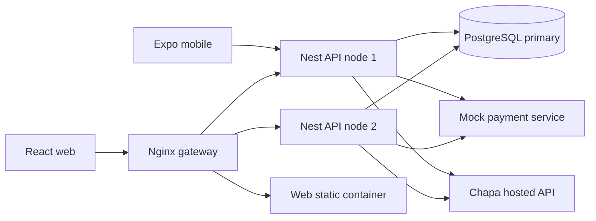
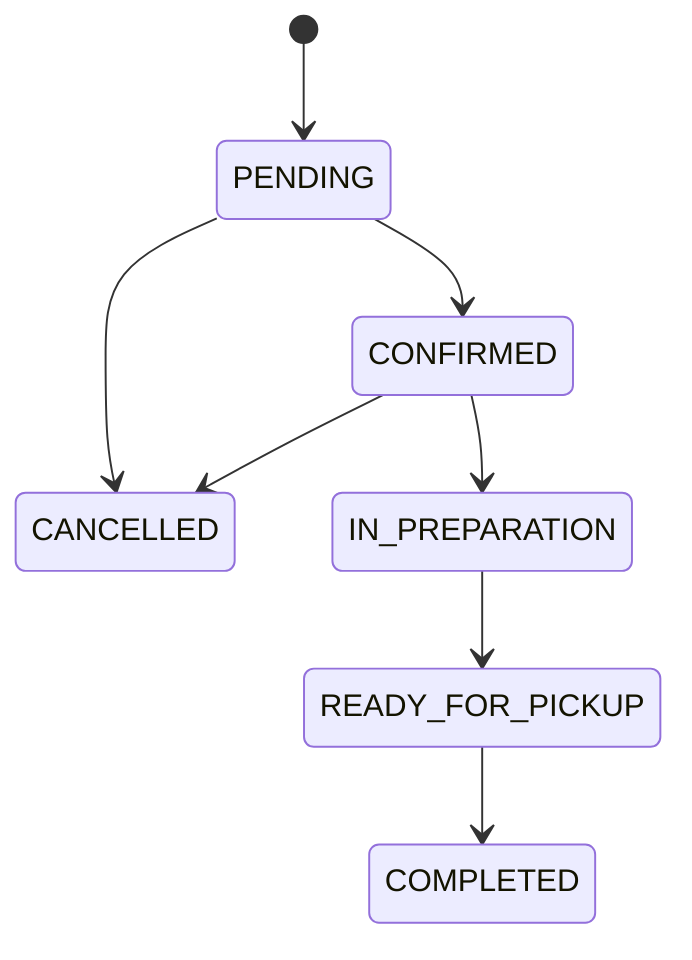

# Architecture Pack

## System overview

Akufada is a TypeScript monorepo with a NestJS REST API, React web client, Expo React Native mobile client, PostgreSQL database managed through Prisma, a mock payment service, and an optional Docker Compose/Nginx gateway topology. The clients share domain contracts from packages/shared. This is a modular monolith at the API layer; Docker Compose can start two API processes against one database.

## Components and responsibility

| Component | Implementation | Responsibility |
|---|---|---|
| Web | apps/web; React 18, Vite | Customer catalog/checkout/orders, staff queue and admin workflows. |
| Mobile | apps/mobile; Expo SDK 58, React Native 0.88 | Customer authentication, catalog, cart, checkout, order history and tracking. |
| API | apps/backend; NestJS 10, TypeScript | Auth, validation, roles, business rules, catalog, inventory, orders, reports, audit and payment integration. |
| Shared package | packages/shared | Shared enums, interfaces and domain contracts. |
| Database | PostgreSQL, Prisma 5 | Persistent users, roles, products, inventory, orders, payment records, history, idempotency and audit records. |
| Payment mock | apps/mock-payment | Local external-service simulation for payment outcomes and failure scenarios. |
| Gateway | deploy/nginx | Optional HTTP routing, two API upstreams, rate zones, access logs and proxy controls. |

## Architectural style and rationale

The backend separates domain areas into Nest modules and controllers/services. Prisma models relational data. The web and mobile clients call the same versioned API. The API owns pricing and stock decisions; the client does not authoritatively set totals. This arrangement supports consistent rules across clients. It does not constitute independently deployed microservices: the payment mock is a separate process, while business modules run inside one API application.

## Configured topology

    Web React dev :3000 / web container :80 ---> Nginx gateway :80 or TLS overlay
    Mobile Expo :8081 ------------------------> API node(s) :3001
    Nginx ---> API node 1 :3001 and API node 2 :3001
    Nginx ---> web static container :80
    API nodes ---> PostgreSQL :5432
    API nodes ---> mock payment service :4000
    API nodes ---> Chapa hosted API

This is the configured topology, not proof that it is deployed. PostgreSQL is a single primary. The TLS Compose overlay mounts a certificate directory, but no certificate or successful TLS run was verified. The gateway publishes port 80 by default and can publish 443 with the TLS overlay.

## Authentication and order data flows

### Authentication

1. A client sends registration or login credentials to the public auth endpoint.
2. The API validates the DTO, hashes passwords with bcryptjs, and issues access/refresh credentials.
3. Refresh tokens are stored as hashes in PostgreSQL and rotated on refresh; logout revokes active refresh tokens.
4. Web stores auth state in its client context. Mobile uses Expo SecureStore through secure-session utilities.
5. Protected routes validate the bearer access token, attach the current user, and enforce required roles.

### Order placement

1. An authenticated customer sends product UUIDs and quantities; optional customer notes and payment selection are accepted.
2. The API loads current active products/prices and calculates totals server-side.
3. Optional Idempotency-Key uses a SHA-256 request fingerprint and persisted key record to replay completed responses or reject conflicting/concurrent submissions.
4. Inventory rows are locked in deterministic product-ID order and decremented with stock-movement entries in a transaction.
5. Order, item price/name snapshots, history and payment record are persisted according to the selected provider.
6. Mock checkout simulates selected outcomes. Cash on pickup remains pending for collection. Chapa initializes hosted checkout; its browser return is not trusted as proof of payment.
7. Chapa status is verified server-to-server through callback/customer verification/webhook handling and periodic reconciliation. Confirmed payment state updates are applied to pending records.
8. Customer reads tracking/history; staff advances state through the allowed lifecycle.

## Order lifecycle

Source transition map:

    PENDING -> CONFIRMED -> IN_PREPARATION -> READY_FOR_PICKUP -> COMPLETED
       |             |
       +-------------+-> CANCELLED

Permitted transitions are enforced in OrdersService. Payment state is distinct from preparation status. Do not treat an order as paid solely because a browser reached the return URL.

## Trust boundaries and security controls

- Browser/mobile clients are untrusted; server recomputes price and validates requested products and quantities.
- Protected routes use JWT authentication and role checks. Admin and staff boundaries are present in controllers.
- Global class-validator pipe transforms DTOs, rejects unknown properties, and strips non-whitelisted values.
- Password hashes and hashed refresh tokens are persisted rather than raw credentials.
- Database constraints enforce uniqueness, foreign keys and key nonnegative/exact-total conditions.
- Order inventory changes use row locks/transactions; gateway retries can fail over between API nodes.
- Chapa secret and webhook values are server configuration; never expose them to clients or evidence.
- Backend adds selected response headers and explicitly configured CORS origins. Nginx config adds request rate zones, request size limit, proxy timeouts and access logs.
- TLS termination is intended at Nginx via a separate overlay; cert provisioning, HSTS and deployment TLS verification were not confirmed.

## External services and failure behavior

The payment client calls Chapa API using a server-side private/secret key, timeout configuration, response verification, and bounded retry behavior for transient conditions. Chapa webhooks are HMAC checked against the raw body and successful payment state is verified with Chapa before applying. A reconciliation interval scans aged pending Chapa payments. Mock service tests cover outcomes and retry behavior. These mechanisms have not been exercised in a live deployment for this package.

## Scalability and failure limits

Two API containers and Nginx round-robin/upstream failure settings are configured. They share one PostgreSQL primary; there is no configured database replica, multi-zone topology or tested disaster recovery result. The application emits health endpoints and gateway JSON logs, but no monitoring/alerting stack was found. A background reconciliation timer is process-local, so each API replica may independently reconcile pending records; payment state update logic must remain idempotent under this arrangement.

## Recommended improvements

Capture an actual end-to-end run, configure and verify TLS with deployment-specific CORS, add external monitoring/alerting and durable worker coordination, verify operational restore/rollback, and consider structured item customization as a persisted schema feature. Add a database replica only with a defined consistency/failover test and operating plan.
